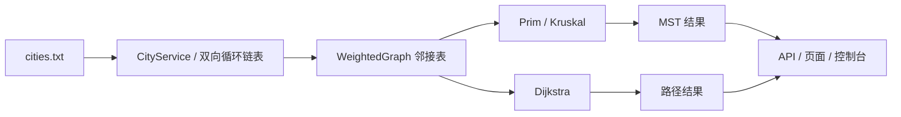
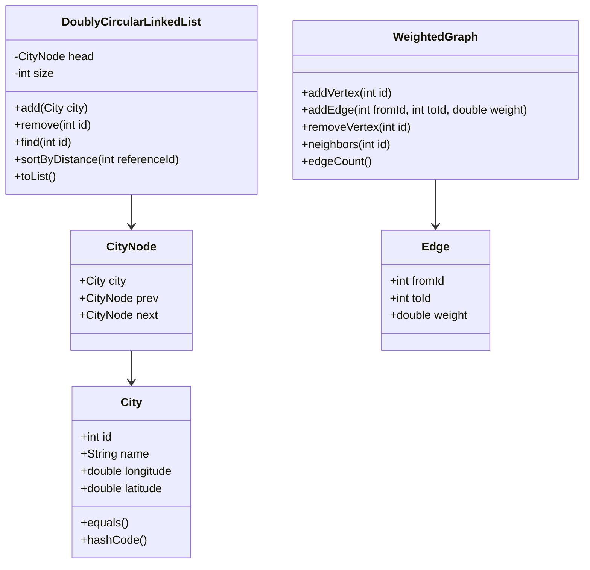

# 城市间物流网络联通规划系统 · 开发文档

> 数据结构综合性实践（第二组）：线性表 + 图 + 最小生成树 + 最短路径
>
> 文档版本：v1.1　　创建日期：2026-10-28　　截止日期：2026-11-15
> 编写人：黄予函

**修订记录**

| 版本 | 日期 | 作者 | 说明 |
|---|---|---|---|
| v1.0 | 2026-10-28 | 黄予函 | 初稿 |
| v1.1 | 2026-10-28 | 黄予函 | 补距离模型、核心设计、权限、接口细节、测试计划、工程化清单；修正示例数据和天数口径；**分工未改** |

**v1.1 改了什么（先看这里）**

1. 定死距离公式。原来只写“欧氏距离”，示例数值对不上，本版给出唯一公式和单位。
2. 写清 Dijkstra 在原图上跑，并解释作业里“基于生成树”这句话怎么理解。
3. 补“排序后的链表”“完整邻接表”两个输出接口和页面。
4. 补权限矩阵、登录方式、401/403 处理。
5. 补“增删城市后怎么更新 MST 和路径”的规则。
6. 示例改成同一套公式算出的 8 城数据，并说明 30 城正式数据以 `cities.txt` 为准。
7. 新增第 4 章“核心设计”、第 9 章“测试计划”、第 12 章附录。
8. 修正“共 18 天”为“19 个自然日”；补 `.gitignore`、编码、README 等工程化要求。
9. **1.4 团队分工、2.3 和 2.4 的人员安排保持 v1.0 不变。**

> 阅读提示：第 4 章是核心设计，答辩重点看这一章；第 9 章是测试与验收；第 12 章附录有示例数据和需求追溯表。

---

## 目录

1. [项目概述](#一项目概述)
2. [阶段分期与排期](#二阶段分期与排期)
3. [项目目录结构](#三项目目录结构)
4. [核心设计](#四核心设计)
5. [命名规范](#五命名规范)
6. [代码规范](#六代码规范)
7. [接口设计规范](#七接口设计规范)
8. [协作规范](#八协作规范)
9. [测试计划](#九测试计划)
10. [风险与应对](#十风险与应对)
11. [交付物清单](#十一交付物清单)
12. [附录](#十二附录)

---

## 一、项目概述

### 1.1 项目背景

某物流公司要在 30 个城市建仓储节点，节点之间铺光纤专线。要求两点：

- 全网连通，铺设总成本最低。这就是最小生成树（MST）。
- 任意两个仓库之间能查最短路径，查询要快。

课程第二组要求用**双向循环链表**管理城市，用**邻接表**存图，用 **Prim、Kruskal** 求 MST，用 **Dijkstra** 求最短路。

### 1.2 项目目标

| 编号 | 目标 | 验收时看什么 |
|---|---|---|
| G1 | 用双向循环链表管理 30 个城市，支持增删改查、按距离排序 | 能打印 `head → … → head`，能按距离升序输出 |
| G2 | 用邻接表建带权无向图，边权为两城距离 | 30 城应有 435 条边，每条边双向等权 |
| G3 | 用 Prim、Kruskal 求 MST，输出总权值和所有边 | 两种算法总权值相同，30 城应有 29 条边 |
| G4 | 用 Dijkstra 求任意两城最短路，输出完整路径和代价 | 路径首尾正确，代价等于路径边权之和 |
| G5 | 系统界面，至少 2 种角色，增删城市后更新 MST 和路径 | 管理员能增删，普通用户只能查；改完能马上看到新结果 |
| G6 | 四类结果都能看到：排序链表、邻接表、MST、路径 | 页面能看，控制台也能打印，报告能截图 |

> 关于 G4：最短路在**原来的图**上跑，不是在 MST 上跑。原因见 4.6。

### 1.3 技术栈

| 层 | 技术 | 版本 | 说明 |
|---|---|---|---|
| 后端语言 | Java | JDK 25 | 数据结构和算法全部手写 |
| 后端框架 | Spring Boot | 4.1.x | 提供 REST API |
| 后端构建 | Maven | 3.9+ | 用 `mvnw` 统一版本 |
| 前端框架 | Vue | 3.4+ | Composition API |
| 前端构建 | Vite | 5.x | 开发服务器和打包 |
| 路由 | Vue Router | 4.x | 页面路由 |
| 状态管理 | Pinia | 2.x | 用户和角色 |
| UI 组件 | Element Plus | 2.x（锁版本） | 表格、表单、菜单 |
| 图可视化 | AntV G6 | 5.x | 节点、边、MST 高亮 |
| HTTP 请求 | axios | 1.x | 统一封装 |
| 运行环境 | Node.js | 24 LTS | 前后端都锁定版本 |
| 数据 | 本地文件 | `cities.txt` | UTF-8，30 行 |
| 版本控制 | Git | — | 托管代码 |

> 版本说明：本机已装 JDK 25，骨架用 JDK 25 + Spring Boot 4.1.2。如果课程要求 JDK 21，把 `logistics-server/pom.xml` 的 `<java.version>` 改成 21，父版本改成 3.5.x；Java 代码不用动。

**版本要求**：所有依赖写具体版本，提交 `package-lock.json` 或 `pnpm-lock.yaml`。不要写“最新版”。

### 1.4 团队分工

| 成员  | 角色      | 主要职责                  |
| --- | ------- | --------------------- |
| 黄予函 | 后端 + 前端 | 后端架构与路径算法；前端 Vue 全部页面 |
| 郝晟尧 | 后端      | 链表模块、图模块、接口联调、路径算法    |
| 梁敬谦 | 后端      | 链表模块、数据文件、算法测试        |

> 协作原则：**阶段 0 三人共同设计；后端三人合力；前端由黄予函独立完成；联调与答辩全员参与。**

> 本版按小组要求**不改分工**。当前排期下黄予函的任务有重叠，风险写在 10.1，等小组讨论后再决定要不要调整。

### 1.5 范围与红线

**本版要做的：**

- 30 城数据加载、链表管理、邻接表、Prim、Kruskal、Dijkstra。
- 登录、两种角色、增删城市后更新 MST 和路径。
- 四类输出：排序链表、邻接表、MST、路径。
- 控制台演示程序，保证前端出问题时还能答辩。

**本版不做的：**

- 不做手动加边、删边。边由城市坐标自动生成。
- 不做注册、找回密码、用户管理页面。只预置两个账号。
- 不做数据库。数据放内存，启动时从 `cities.txt` 读。重启后恢复初始 30 城；管理员可以点“重置数据”。
- 不做 Spring Security。用简单的登录拦截器。
- 不做手机端适配。
- 不接第三方地图或路径规划 API。

**红线：**

- 链表、图、MST、Dijkstra 必须手写。禁止 JGraphT 等第三方算法库。
- JDK 集合只能当容器用。比如用 `ArrayList` 存邻居可以，但不能用 `Collections.sort` 代替链表排序。
- Prim、Dijkstra 可以用 JDK 自带的 `PriorityQueue`，但要在文档里写明用了它。本项目 n=30，建议直接用数组版，见 4.5、4.6。
- 前端只负责显示，不把算法搬到前端。

> 为什么不做手动加边删边：作业只要求“邻接表存储”和“按坐标算边权”，没要求手动改边。少做一块，时间更稳。如果老师临时要求，再按 P2 补。

---

## 二、阶段分期与排期

> 总周期：2026-10-28（周三）至 2026-11-15（周日）。含首尾共 **19 个自然日**。
> 说明：按时间差算是 18 天，按“从第一天到最后一天”算是 19 天。本版统一写 19 天，避免组内对不上。

### 2.1 总体里程碑

| 里程碑 | 日期 | 达成标准 | 怎么验收 |
|---|---|---|---|
| **M0 设计完成** | 10-30（周五） | 技术栈确定、项目骨架能启动、API 契约定稿、30 城数据就绪 | `mvn spring-boot:run` 和 `npm run dev` 能打开；`docs/api.md` 存在；`cities.txt` 有 30 行 |
| **M1 链表完成** | 11-01（周日） | 双向循环链表增删改查、排序全部通过测试 | `DoublyCircularLinkedListTest` 全绿；控制台能打印排序前后的序列 |
| **M2 图完成** | 11-03（周二） | 邻接表构建、边权计算、边管理通过测试 | 30 个节点、435 条边；邻接表能输出 30 行 |
| **M3 后端完成** | 11-06（周五） | Prim、Kruskal、Dijkstra 完成，REST API 全部能调 | `mvn test` 全绿；4 个核心接口能返回正确 JSON；两种 MST 总权值相同 |
| **M4 前端完成** | 11-10（周二） | 所有页面、图可视化、交互完成 | 6 个页面能打开；mock 数据能显示 |
| **M5 联调完成** | 11-12（周四） | 前后端对接、动态更新、角色权限全部验证 | 以 30 城、29 条边为基准：新增一个城市后 30 条，删除一个后 28 条；普通用户写接口返回 403 |
| **M6 交付** | 11-15（周日） | 测试、报告、PPT、演示演练全部完成 | 报告、PPT、录屏、演示脚本齐全；每人都能独立启动 |

### 2.2 阶段 0：需求分析与设计（10-28 ~ 10-30，3 天）

| 日期 | 任务 | 负责人 | 产出 |
|---|---|---|---|
| 10-28 | 需求拆解、技术栈确认、环境安装（JDK/Maven/Node） | 全员 | 任务清单、开发环境 |
| 10-29 | 定义核心类（City/CityNode/Edge）、设计 API 契约、统一响应格式 | 全员 | API 契约文档、JSON 示例、类图 |
| 10-30 | 搭建前后端骨架、准备 30 城数据、跑通 Hello World | 全员 | 可启动的前后端工程、`cities.txt` |

> 建议：10-30 抽半天做一个 G6 最小 demo，只画 30 个节点和 29 条 MST 边。谁有空谁做，不改变原分工。G6 是本项目最不确定的技术，早试早换。

### 2.3 阶段 1：后端核心（10-31 ~ 11-06，7 天）

| 日期            | 任务                                   | 成员      | 产出                                 |
| ------------- | ------------------------------------ | ------- | ---------------------------------- |
| 10-31 ~ 11-01 | 双向循环链表：节点定义、增删改查、空链表/头节点边界、按距离排序     | 梁敬谦、郝晟尧 | `DoublyCircularLinkedList` + 测试    |
| 11-02 ~ 11-03 | 邻接表图：图结构、欧氏距离、无向边双向插入、边的增删           | 郝晟尧、梁敬谦 | `WeightedGraph` + 测试               |
| 11-04 ~ 11-05 | Prim、Kruskal（含并查集）、MST 总权值与边输出       | 黄予函、郝晟尧 | `PrimMST`/`KruskalMST`/`UnionFind` |
| 11-05 ~ 11-06 | Dijkstra（含路径还原）、Controller 接口、统一异常处理 | 黄予函、梁敬谦 | `DijkstraShortestPath`、Controller  |

> 说明：
> - 表里的“边的增删”是图结构内部的 `addEdge/removeEdge`，用来写测试，不对外提供接口。用户不能手动加边删边。
> - 每个模块写完当天就写单元测试，不要留到 M5。测试拖到最后，一定来不及。

### 2.4 阶段 2：前端开发（11-05 ~ 11-10，6 天，与后端尾部并行）

> 启动条件：API 契约定稿（M0 已完成），不必等后端 100% 完成。

| 日期 | 任务 | 产出 |
|---|---|---|
| 11-05 | Vue 工程、路由、Pinia、登录页、整体布局 | 可运行的前端框架 |
| 11-06 ~ 11-07 | 城市管理页（增删改查）、MST 展示页 | 管理与 MST 页面 |
| 11-08 ~ 11-09 | 路径查询页、G6 图可视化（节点/边、MST 高亮、路径动画） | 图可视化与查询 |
| 11-10 | 双角色菜单权限、交互细节、页面联调自测 | 完整前端 |

> 11-05 后端接口还没全好，前端先用 mock 数据。mock 文件放 `src/mock/`，字段按第 7 章来。不要等后端。

### 2.5 阶段 3：前后端联调（11-09 ~ 11-12，4 天）

| 日期 | 任务 |
|---|---|
| 11-09 ~ 11-10 | 跨域配置、接口字段对齐、城市管理接口联调 |
| 11-11 | MST、最短路径接口联调，图可视化数据对接 |
| 11-12 | 增删城市后 MST/路径动态更新、双角色权限验证、bug 修复 |

> 11-12 之后进入**代码冻结**。只修 bug，不加新功能。新功能一律记到 P2，答辩后再做。

### 2.6 阶段 4：测试与答辩（11-13 ~ 11-15，3 天）

| 日期 | 任务 |
|---|---|
| 11-13 | 全面功能测试、边界测试、性能耗时统计（Prim vs Kruskal）、bug 修复 |
| 11-14 | 实验报告、算法分析（邻接矩阵 vs 表、MST 对比）、答辩 PPT |
| 11-15 | 全流程演示演练、确保每人能独立启动项目、最终检查 |

> 报告不要等到 11-14 才写。11-06 开始，每完成一个模块就补一节：截图、复杂度、遇到的问题。11-14 只做汇总和排版。

### 2.7 优先级与降级方案

| 级别 | 内容 | 延期时怎么办 |
|---|---|---|
| **P0** | 链表增删改查 + 按距离排序、邻接表、Prim、Kruskal、Dijkstra、2 种角色、增删城市后更新、四类输出、登录 | 不能砍 |
| **P1** | G6 图可视化、MST 高亮、角色菜单、路径动画、性能对比页 | 先砍动画，再砍 G6，退到表格 + 简单 SVG |
| **P2** | 全量路径矩阵、导出 CSV、深色主题、稀疏图模式、生成树路径模式 | 有时间再做 |

> 延期时先砍 P2，再砍 P1 的动画。P0 不动。

---

## 三、项目目录结构

### 3.1 仓库总体结构

```
logistics-network/                # Git 仓库根目录
├── docs/                         # 文档
│   ├── 开发文档.md                # 本文档
│   ├── api.md                    # API 契约
│   └── report/                   # 报告素材、截图
├── logistics-server/             # 后端（Spring Boot + Maven）
├── logistics-web/                # 前端（Vue 3 + Vite）
├── scripts/                      # 启动、测试、基准脚本
├── .gitignore
├── .editorconfig
├── .gitattributes
└── README.md
```

### 3.2 后端目录结构

```
logistics-server/
├── pom.xml
├── mvnw
├── mvnw.cmd
└── src/
    ├── main/
    │   ├── java/com/logistics/
    │   │   ├── LogisticsApplication.java       # 启动类
    │   │   ├── controller/                     # 控制层
    │   │   │   ├── CityController.java
    │   │   │   ├── GraphController.java
    │   │   │   ├── MstController.java
    │   │   │   ├── PathController.java
    │   │   │   ├── AuthController.java
    │   │   │   └── AdminController.java
    │   │   ├── service/                        # 业务层
    │   │   │   ├── CityService.java
    │   │   │   ├── GraphService.java
    │   │   │   ├── MstService.java
    │   │   │   ├── PathService.java
    │   │   │   └── AuthService.java
    │   │   ├── model/                          # 数据模型
    │   │   │   ├── City.java
    │   │   │   ├── Edge.java
    │   │   │   └── User.java
    │   │   ├── dto/                            # 对外返回的对象
    │   │   │   ├── CityDTO.java
    │   │   │   ├── AdjacencyDTO.java
    │   │   │   ├── MstDTO.java
    │   │   │   ├── PathDTO.java
    │   │   │   ├── LoginRequest.java
    │   │   │   └── LoginResponse.java
    │   │   ├── structure/                     # 手写数据结构
    │   │   │   ├── CityNode.java
    │   │   │   ├── DoublyCircularLinkedList.java
    │   │   │   └── WeightedGraph.java
    │   │   ├── algorithm/                      # 手写算法
    │   │   │   ├── mst/
    │   │   │   │   ├── PrimMST.java
    │   │   │   │   ├── KruskalMST.java
    │   │   │   │   └── UnionFind.java
    │   │   │   └── path/
    │   │   │       └── DijkstraShortestPath.java
    │   │   ├── common/                         # 统一响应、异常
    │   │   │   ├── Result.java
    │   │   │   ├── ResultCode.java
    │   │   │   └── GlobalExceptionHandler.java
    │   │   ├── config/                         # 配置
    │   │   │   ├── WebConfig.java              # 编码、CORS、拦截器注册
    │   │   │   └── AuthInterceptor.java        # 登录和角色检查
    │   │   ├── auth/                           # 权限注解
    │   │   │   ├── RequireRole.java
    │   │   │   └── Role.java
    │   │   ├── exception/                      # 自定义异常
    │   │   │   ├── CityNotFoundException.java
    │   │   │   ├── DuplicateCityException.java
    │   │   │   └── InvalidCoordinateException.java
    │   │   ├── util/
    │   │   │   └── DistanceUtil.java
    │   │   ├── cli/
    │   │   │   └── ConsoleRunner.java          # 控制台演示，答辩兜底
    │   │   └── benchmark/
    │   │       └── BenchmarkRunner.java        # 性能对比，不进生产接口
    │   └── resources/
    │       ├── application.yml
    │       └── data/cities.txt                 # 30 城数据
    └── test/java/com/logistics/
        ├── structure/
        ├── algorithm/
        ├── service/
        └── controller/
```

### 3.3 前端目录结构

```
logistics-web/
├── package.json
├── vite.config.js
├── index.html
└── src/
    ├── main.js
    ├── App.vue
    ├── api/                          # 接口请求
    │   ├── request.js                # axios 实例、拦截器
    │   ├── auth.js
    │   ├── city.js
    │   ├── graph.js
    │   ├── mst.js
    │   └── path.js
    ├── views/
    │   ├── login/LoginView.vue
    │   ├── city/CityManageView.vue   # 增删改查
    │   ├── city/CityListView.vue     # 排序后的链表视图
    │   ├── graph/AdjacencyView.vue   # 邻接表视图
    │   ├── mst/MstView.vue
    │   ├── path/PathView.vue
    │   └── NotFoundView.vue
    ├── components/
    │   ├── layout/
    │   │   ├── AppLayout.vue
    │   │   └── AppMenu.vue
    │   └── graph/
    │       └── NetworkGraph.vue      # G6 图
    ├── router/
    │   └── index.js                  # 路由 + 登录守卫
    ├── stores/
    │   └── user.js
    ├── utils/
    │   └── auth.js                   # token 存取
    ├── mock/                         # 前端 mock 数据
    └── assets/
```

### 3.4 目录和作业要求的对应

| 作业要求 | 后端 | 前端 |
|---|---|---|
| 排序后的完整链表序列 | `CityService.sortByDistance` / `ConsoleRunner` | `CityListView` |
| 完整的邻接表结构 | `GraphService.adjacency` | `AdjacencyView` |
| MST 总权值和所有边 | `MstService` | `MstView` |
| 完整路径和总代价 | `PathService` | `PathView` |
| 2 种角色 | `AuthService` / `AuthInterceptor` | `LoginView` / `AppMenu` |
| 增删城市后更新 | `CityService` 调 `GraphService` 重建 | `CityManageView` |

### 3.5 仓库规范

**`.gitignore` 至少包含：**

```
target/
bin/
node_modules/
dist/
.idea/
.vscode/
*.iml
*.log
.DS_Store
```

> `.vscode/` 默认不提交。如果团队要共享配置，单独发文件，不要提交个人设置。

**`.editorconfig`：**

```
root = true

[*]
charset = utf-8
end_of_line = lf
insert_final_newline = true
trim_trailing_whitespace = true

[*.java]
indent_style = space
indent_size = 4

[*.{js,vue,css,json,yml}]
indent_style = space
indent_size = 2
```

**`.gitattributes`：**

```
* text=auto eol=lf
*.bat eol=crlf
*.cmd eol=crlf
*.png binary
*.jpg binary
```

**其他要求：**

- 提交 `package-lock.json` 或 `pnpm-lock.yaml`。
- 不提交 `target/`、`node_modules/`、`dist/`、`.idea/`。
- `README.md` 写清：JDK 25、Maven 3.10、Node 24、启动命令、端口（8080/5173）、初始账号、常见问题。
- 提供 `scripts/start.ps1` 或 `scripts/start.sh`，一条命令启动前后端。

---

## 四、核心设计

> 这一章是答辩重点。前面几章是“怎么管项目”，这一章是“怎么做出来”。

### 4.1 数据流



用一句话说：

- 链表是城市的主数据。
- 图从链表派生。
- MST 和路径都从图算。
- 所有写操作走 `CityService`，改完把 `graphVersion` 加 1。
- 缓存只要发现版本对不上，就重算。

#### 4.1.1 核心类图



> 这张图只画核心类，Controller、Service、DTO 不画，避免太乱。

### 4.2 距离模型（本版新增，最优先看）

**公式：**

```
dx = (lon2 - lon1) × 111.32 × cos((lat1 + lat2) / 2)
dy = (lat2 - lat1) × 111.32
d  = sqrt(dx² + dy²)
w  = round(d, 2)          // 单位 km，保留 2 位
```

**规则：**

1. 单位统一用 km。
2. 每度按 111.32 km 算。全组统一，不许有人用 111，有人用 111.32。
3. 经度方向乘 `cos(平均纬度)`，所以 `w(A,B) = w(B,A)`，无向边不会不对称。
4. 建边时就把权值四舍五入到 2 位。
5. MST 的总权值 = 所有边的**已取整权值**相加。最后再保留 2 位，避免浮点误差。
6. 权值相同时，按 `(weight, 较小 id, 较大 id)` 排序，保证 Prim 和 Kruskal 每次输出一致。
7. 两城坐标完全相同，距离为 0，允许；但要在测试里覆盖。
8. 取整用 `Math.round(d * 100) / 100.0`，全组统一。不要用 `String.format` 转成字符串再转回 `double`。

**为什么不用“起点的纬度”？**

如果用 `cos(lat1)`，北京→沈阳和沈阳→北京会算出两个不同的数。无向图要求两个方向一样。这是错误，不是精度问题。

**测试用的已知值（按上面的公式，8 城演示数据）：**

| 城市对 | 期望权重（km） |
|---|---:|
| 北京—上海 | 1068.39 |
| 北京—沈阳 | 627.82 |
| 北京—西安 | 911.96 |
| 广州—武汉 | 829.24 |
| 上海—杭州 | 163.27 |
| 成都—西安 | 608.82 |
| 武汉—杭州 | 565.37 |

> 这组数只用于测试和示例。30 城的正式数据由程序算，不要手抄。

### 4.3 双向循环链表

**节点结构：**

```java
class CityNode {
    City city;
    CityNode prev;
    CityNode next;
}
```

**链表结构：**

- 带一个哨兵头节点 `head`。`head` 不存城市。
- 空链表：`head.next == head`，`head.prev == head`。
- 非空：`head.next` 是第一个城市，`head.prev` 是最后一个城市。
- 每个节点的 `next.prev == 自己`，`prev.next == 自己`。

**必须成立的不变量：**

1. `head.next.prev == head`，`head.prev.next == head`。
2. 从 `head.next` 一直往后走，能回到 `head`。
3. `size` 等于实际节点数。
4. 没有重复的城市 id。

**操作和复杂度：**

| 操作 | 做法 | 时间 |
|---|---|---|
| 尾部插入 | 用 `head.prev` 找尾节点，接上新节点 | O(1) |
| 按距离插入 | 从头往后找第一个比它大的节点，插在前面 | O(n) |
| 删除 | 拿到节点后，用 `prev` 和 `next` 直接摘掉 | O(1) |
| 查找 | 从头遍历 | O(n) |
| 按距离排序 | 链表插入排序（或归并排序） | O(n²) / O(n log n) |
| 输出 | 从 `head.next` 走到 `head` | O(n) |

**“按距离排序”的参照点：**

作业只说“按距离排序”，没说离哪里。本版规定：

- 默认参照城市是北京（id=1000）。
- 按到参照城市的距离**升序**。
- 距离相同，按 id 升序。
- 接口可以传 `reference` 参数换参照城市。

> 链表本身按“当前参照城市”排序。换参照城市会触发一次链表重排，正好用来演示链表排序。不传就用北京。新增城市按当前顺序插入，不整体重排。
> 如果参照城市被删除，自动改用 id 最小的城市，并在返回里带上新的 `reference`。

**排序怎么实现：**

- 手写**插入排序**：从原链表一个个摘下来，按距离插到新链表。O(n²)，30 个节点很快，答辩也好讲。
- 或者手写**归并排序**：O(n log n)，指针重连，加分。
- **禁止** `Collections.sort(list)`。那就不是“手写链表排序”了。

**动态排序：**

- 新增城市：按距离插到正确位置，O(n)。
- 删除城市：直接摘掉，不用重排。
- 修改坐标：先改坐标，再重排。
- 修改名称：不影响顺序。

**为什么删除双向链表比单链表快：**

- 双向链表：拿到要删的节点，直接 `node.prev.next = node.next`、`node.next.prev = node.prev`，O(1)。
- 单链表：只知道要删的节点，还得从头找到它的前一个节点，O(n)。
- 这就是作业问题 (1) 的答案，报告里要写。

**输出格式：**

```
head → 北京 → 沈阳 → 上海 → … → 北京（回到 head）
```

每个节点同时打印 `prev` 和 `next` 的城市名，证明是“双向 + 循环”。

### 4.4 图（邻接表）

**图的规模：**

- 30 个城市，任意两城都建边，所以是**完全图**。
- 边数 E = 30 × 29 / 2 = **435**。
- 邻接表里每条边存两次，共 870 条边记录。

**存储：**

```java
Map<Integer, List<Edge>> adjacency;   // cityId -> 邻居边
```

或者用数组 + 链表。用 `Map` 是为了按 id 找邻居方便。`Edge` 里存 `fromId`、`toId`、`weight`。

**边的规范化：**

- 建边时保证 `fromId < toId`。
- 两个方向存同样的 `weight`。
- 这样 `w(A,B) == w(B,A)`，Prim、Kruskal 不会出错。

**操作：**

| 操作 | 说明 | 时间 |
|---|---|---|
| 加节点 | `adjacency.put(id, new ArrayList<>())` | O(1) |
| 加边 | 两个方向各加一条 | O(1) |
| 删节点 | 删除该节点，再删所有和它相连的边 | O(n) |
| 删边 | 两个方向各删一条 | O(deg) |
| 查邻居 | 返回 `adjacency.get(id)` | O(1) |
| 边数 | 维护 `edgeCount` | O(1) |

> 这里的加边、删边是图结构的内部方法，用来建图和写测试，不对外提供接口。

**邻接表输出格式（作业要求“完整邻接表结构示意图”）：**

```json
[
  {
    "cityId": 1000,
    "cityName": "北京",
    "neighbors": [
      { "toId": 1001, "toName": "上海", "weight": 1068.39 },
      { "toId": 1007, "toName": "沈阳", "weight": 627.82 }
    ]
  }
]
```

前端用表格或折叠面板展示，支持导出 CSV/文本。报告截图就用这个页面。

**邻接矩阵 vs 邻接表（作业问题 2）：**

| 比较项 | 邻接矩阵 | 邻接表 |
|---|---|---|
| 空间 | n² = 900 个单元 | 30 + 870 条记录 |
| 判断两点有没有边 | O(1) | O(deg) |
| 遍历一个点的邻居 | O(n) | O(deg) |
| 适合 | 稠密图 | 稀疏图 |
| 本场景 | 30 城是完全图，矩阵其实也合适 | 作业要求用邻接表，所以用它 |

报告里要写清楚：**我们按作业要求用邻接表；本场景是完全图，矩阵在 n=30 时也不差。邻接表的优势在稀疏图和“只遍历邻居”的时候。** 这样回答才算完整。

### 4.5 最小生成树（Prim、Kruskal）

**Prim（适合稠密图，n=30 用数组版）：**

1. 随便选一个起点，放进“已选集合”。
2. 维护 `minDist[]`：每个未选点到已选集合的最短边。
3. 每次选 `minDist` 最小的未选点，加入集合，更新 `minDist`。
4. 重复 n-1 次，得到 n-1 条边。

- 时间 O(V²) = 900 次操作。
- 空间 O(V)。
- 不需要优先队列，也没有 decrease-key 的麻烦。

**Kruskal（适合稀疏图）：**

1. 把所有边按 `(weight, fromId, toId)` 排序。
2. 用并查集，从小到大取边。
3. 如果两个端点不在一个集合，就选这条边，合并集合。
4. 选够 n-1 条边就停。

- 时间 O(E log E) = 435 × log435，很小。
- 并查集用路径压缩 + 按秩合并。

**输出：**

- `totalWeight`：总权值。
- `edges`：n-1 条边，每条有 `fromId/fromName/toId/toName/weight`。
- `connected`：是否连通。30 城完全图一定是 `true`；如果测试里造了不连通图，就是 `false`，此时输出最小生成森林。
- `edgeCount`：选中的边数。

**两种算法要对上：**

- 同一张图，Prim 和 Kruskal 的 `totalWeight` 必须相等。
- 有相等权值时，选出的边可能不同，但总权值必须相同。测试断言“总权值相等 + 边数 = n-1”，不要断言边集完全相同。
- 本版用 4.2 的 tie-break 规则，让两种算法输出也尽量一致，方便截图对比。

**边界：**

- n=0：总权值 0，边为空，`connected=false`（没有城市）。
- n=1：总权值 0，边为空，`connected=true`。
- 不连通：`connected=false`，边数小于 n-1。

### 4.6 最短路径（Dijkstra）

**先说清楚：在哪个图上跑？**

作业原文是“再基于生成树的拓扑结构，用 Dijkstra 算法实现任意两个城市之间的最短路径查询”。

这句话有两种理解：

- (a) 在 MST 上跑。MST 是树，两点之间只有一条路，Dijkstra 退化成“找唯一路径”，算出来的不是原图最短路。
- (b) 在原图上跑。这才是标准的最短路，MST 只是阶段三的另一个结果。

**本版选 (b)：在原图上跑。** 理由：

- 作业要的是“任意两个城市之间的最短路径”，不是“生成树上的唯一路径”。
- MST 的用途是“铺设总成本最低”，不是“路径最短”。
- 如果老师坚持 (a)，我们加一个可选参数 `mode=tree`，在 MST 上跑一遍，作为对照。两种结果都能演示。

**Dijkstra 做法（n=30 用数组版）：**

1. `dist[]` 全部设为无穷大，`dist[from] = 0`。
2. `visited[]` 全部为 false。
3. 每次找 `dist` 最小且未访问的点 u，标记已访问。
4. 用 u 的邻居 v 做松弛：如果 `dist[u] + w(u,v) < dist[v]`，更新 `dist[v]`，并记 `prev[v] = u`。
5. 重复 n 次，或提前弹出 `to`。
6. 从 `to` 沿 `prev` 往回走，得到路径，再反转。

- 时间 O(V²) = 900 次操作。
- 空间 O(V)。
- 边权必须非负。欧氏距离天然非负。

**一个容易忽略的现象：最短路常常就是直连。**

因为任意两城都直连，而且直线距离满足“三角形两边之和大于第三边”，所以从 A 到 B 的最短路通常就是 A—B 这条边。程序输出 `[A, B]` 是对的，不是 bug。

答辩时如果老师问“为什么没有中转”，就这样回答：

> 我们的图是完全图，任意两城都有直连边。欧氏距离满足三角不等式，所以直连就是最短。Dijkstra 的价值在于验证算法、处理等权边和异常输入，不是一定要走出多跳路径。

如果想让演示有中转，用 `mode=tree`（在 MST 上走，路径唯一，一定多跳），或者做 P2 的“稀疏图模式”（只保留 800 km 以内的边）。默认还是原图。

**边界：**

- `from == to`：路径 `[from]`，代价 0。
- `from` 或 `to` 不存在：404。
- 不可达：`found=false`，`cost=null`。完全图不会出现，但代码要处理。
- 等权最短路：按 `(cost, 节点 id 序列)` 选一条固定的，保证每次演示一样。

**返回：**

- `found`、`cost`、`hops`（边数）、`path`（城市 id + 名称）、`elapsedNanos`、`graphVersion`、`mode`。

### 4.7 增删城市后怎么更新

**唯一数据源：`CityService` 里的链表。** 图从链表派生，不要让链表和图各改各的。

| 操作 | 链表 | 图 | 缓存 |
|---|---|---|---|
| 新增城市 | 按距离插到正确位置 | 加节点，和新城市之外的每个城市建边（30 城时新增 30 条） | `graphVersion++` |
| 删除城市 | 摘掉节点 | 删节点，删所有关联边 | `graphVersion++` |
| 修改坐标 | 改坐标，重排 | 重算该城市与其余每个城市的边权（30 城时 29 条） | `graphVersion++` |
| 修改名称 | 不影响顺序 | 不改边 | `graphVersion++`（显示缓存要失效） |

> 如果删掉的是参照城市，参照自动改成 id 最小的城市，链表重排一次。

**为什么用全量重算，不做增量：**

- n=30，重算 MST 和一次最短路是微秒级。
- 增量算法复杂，容易出错，时间不值得。
- 全量重算逻辑简单，结果一定对。

**缓存：**

- `MstService` 和 `PathService` 缓存结果，key 里带 `graphVersion`。
- 任何写操作 `graphVersion++`。
- 查询时版本对不上就重算，不要手动清缓存。

**“快速”的目标：**

- 新增/删除一个城市后，重算 MST + 查一次路径，总耗时 < 50 ms。
- 实测通常 < 5 ms。响应里返回 `elapsedNanos`，页面上显示出来，作为“毫秒级”的证据。

**边界：**

- 删到只剩 0 个城市：MST 返回空，路径查询返回 404，页面提示“请先添加城市”。
- 只剩 1 个城市：MST 总权值 0，路径 `from==to` 返回 0。
- 不允许删到 0 个也可以，但要在接口里写清楚。本版允许删到 0，返回空结果。

### 4.8 角色与权限

| 能力 / 接口 | 普通用户 | 管理员 |
|---|:---:|:---:|
| 登录、查看当前用户 | ✓ | ✓ |
| 查看城市、排序链表、邻接表 | ✓ | ✓ |
| 查询 MST、最短路 | ✓ | ✓ |
| 新增、修改、删除城市 | ✗（403） | ✓ |
| 重置演示数据 | ✗ | ✓ |
| 查看性能对比 | ✓ | ✓ |

**账号：**

- 预置两个账号，放内存里，不建数据库。
- `admin / admin123`，角色 `ADMIN`。
- `user / user123`，角色 `USER`。
- 文档里写明：仅用于课程演示，密码明文，不用于真实系统。

**登录流程：**

1. 前端 `POST /api/auth/login`，传用户名和密码。
2. 后端校验，生成一个 UUID 作为 token，存到 `Map<String, User>`。
3. 返回 `{ token, user: { id, username, role } }`。
4. 前端把 token 存 `sessionStorage`。
5. 之后每个请求带 `Authorization: Bearer <token>`。
6. 后端 `AuthInterceptor` 检查 token：
   - 没有或无效：401。
   - 角色不够：403。
7. 前端 axios 拦截器：
   - 401：清 token，跳登录页。
   - 403：提示“没有权限”。
8. 路由守卫：没有 token 不能进业务页；菜单按角色显示。

**不要上 Spring Security。** 时间有限，一个拦截器 + 一个注解就够了。

**注意：** 普通用户必须能查 MST 和最短路。作业场景是“日常配送查询工具”，不能把查询也锁给管理员。

### 4.9 关键边界

| 场景 | 期望行为 |
|---|---|
| 空链表删除/查找 | 不抛异常，返回 `false` / `null` |
| 单节点删除 | 删完 `head.next == head.prev == head`，`size=0` |
| 删除头节点/尾节点 | 环不断，前后指针正确 |
| 重复城市 id | 返回 409，不插入 |
| 重复城市名称 | 返回 409（名称也要求唯一） |
| 经度不在 [-180,180] | 返回 400 |
| 纬度不在 [-90,90] | 返回 400 |
| 两城坐标相同 | 距离 0，允许 |
| `from == to` | 路径 `[from]`，代价 0 |
| `from`/`to` 不存在 | 404 |
| 不可达 | `found=false`，`cost=null` |
| 等权边 | 按 tie-break 规则选固定的一条 |
| 删到 0 个城市 | MST 空，路径返回 404，页面提示“请先添加城市” |
| 参照城市被删除 | 自动改用 id 最小的城市，返回新的 `reference` |
| 只剩 1 个城市 | MST 总权 0，路径 0 |
| 普通用户写接口 | 403 |
| 未登录访问业务接口 | 401 |

### 4.10 复杂度汇总

| 操作 | 时间 | 空间 |
|---|---|---|
| 链表尾部插入 | O(1) | O(1) |
| 链表按序插入 | O(n) | O(1) |
| 链表删除（有节点引用） | O(1) | O(1) |
| 链表查找 | O(n) | O(1) |
| 链表插入排序 | O(n²) | O(1) |
| 建图（n 个点、完全图） | O(n²) | O(n²) |
| 加一条边 | O(1) | O(1) |
| 查邻居 | O(1) 取列表，遍历 O(deg) | O(1) |
| Prim（数组版） | O(n²) | O(n) |
| Kruskal | O(E log E) | O(n + E) |
| Dijkstra（数组版） | O(n²) | O(n) |
| 一次路径查询（n=30） | 900 次操作，微秒级 | O(n) |

---

## 五、命名规范

### 5.1 总则

- 名字要看得懂。用完整英文单词，不用拼音，不用 `a1`、`tmp`、`test2`。
- 同一个项目里风格统一。
- 缩写只用大家都能懂的，比如 `id`、`url`、`api`、`mst`。

### 5.2 Java 命名

| 元素 | 规范 | 示例 |
|---|---|---|
| 包 | 全小写，点分隔 | `com.logistics.algorithm.mst` |
| 类 / 接口 | 大驼峰 | `WeightedGraph`、`CityController` |
| 抽象类 | `Abstract` 或 `Base` 开头 | `BaseGraph` |
| 异常类 | `Exception` 结尾 | `CityNotFoundException` |
| 测试类 | 被测类名 + `Test` | `WeightedGraphTest` |
| 方法 | 小驼峰，动词开头 | `addCity()`、`findShortestPath()` |
| 变量 | 小驼峰 | `cityCount`、`edgeList` |
| 布尔值 | `is` / `has` / `should` 开头 | `isEmpty`、`hasCity` |
| 常量 | 全大写 + 下划线 | `MAX_CITY_COUNT`、`INF` |
| 泛型 | 单个大写字母 | `T`、`E`、`K,V` |
| 枚举 | 类名大驼峰，值全大写 | `Role.ADMIN` |

**方法命名：**

| 操作 | 前缀 | 示例 |
|---|---|---|
| 查询 | `get` / `find` / `list` | `getCity(id)`、`listAll()` |
| 新增 | `add` / `save` | `addCity(city)` |
| 修改 | `update` | `updateCity(city)` |
| 删除 | `delete` / `remove` | `deleteCity(id)` |
| 判断 | `is` / `has` | `hasCity(id)` |

> 本项目 Service 直接用类，不拆“接口 + Impl”。如果以后要拆，实现类再用 `Impl` 结尾。现在不要为了规范而规范。

### 5.3 前端命名

| 元素 | 规范 | 示例 |
|---|---|---|
| 组件文件 | 大驼峰 | `NetworkGraph.vue`、`AppMenu.vue` |
| 页面文件 | 大驼峰，`View` 结尾 | `CityManageView.vue` |
| 普通 JS 文件 | 小驼峰 | `request.js`、`auth.js` |
| 组件名 | 大驼峰，多词 | `<NetworkGraph />` |
| 变量 / 函数 | 小驼峰 | `cityList`、`fetchMst()` |
| 组合式函数 | `use` 开头 | `useUser()` |
| 常量 | 全大写 + 下划线 | `API_BASE_URL` |
| Props | 声明小驼峰，模板短横线 | `:graph-data` |
| CSS 类 | 短横线 | `.city-table`、`.menu-item` |
| 路由 name | 小驼峰 | `cityManage` |
| 路由 path | 短横线 | `/city-manage` |
| Store | `useXxxStore` | `useUserStore` |

### 5.4 数据文件

- 文件名：`cities.txt`，全小写。
- 编码：UTF-8，无 BOM。
- 格式：一行一个城市，空格分隔，推荐 3 列：

```
# name longitude latitude
北京 116.41 39.90
上海 121.47 31.23
```

- id 由程序生成：`1000 + 有效数据行号`（跳过空行和注释，从 0 开始）。这样和作业示例的 3 列格式一致。
- 如果小组已经用了 4 列（`id name lon lat`），也可以，但要在 README 里注明，不能两种混用。
- 种子文件 30 条数据（空行和注释不算），不能多不能少；运行时可以增删城市。加载时校验：数量、经纬度范围、名称不重复。

### 5.5 REST API 命名

- URL 全小写，短横线分隔。
- 一般用名词复数，不用动词。
- 路径不超过 3 层。

| 操作 | 方法 | 路径 |
|---|---|---|
| 查询所有城市 | GET | `/api/cities` |
| 查询单个城市 | GET | `/api/cities/{id}` |
| 新增城市 | POST | `/api/cities` |
| 修改城市 | PUT | `/api/cities/{id}` |
| 删除城市 | DELETE | `/api/cities/{id}` |
| 排序后的链表 | GET | `/api/cities/sorted?reference={id}` |
| 图的节点和边 | GET | `/api/graph` |
| 邻接表 | GET | `/api/graph/adjacency` |
| 最小生成树 | GET | `/api/mst?algorithm=prim` |
| 最短路径 | GET | `/api/paths/shortest?from={id}&to={id}` |
| 登录 | POST | `/api/auth/login` |
| 当前用户 | GET | `/api/auth/me` |
| 退出 | POST | `/api/auth/logout` |
| 重置数据 | POST | `/api/admin/reset` |

> 例外说明：`/api/mst` 是固定术语，保留单数；`/api/auth/login` 是动作，保留动词。其余接口不用动词。这样写，规范和执行才不打架。

### 5.6 Git 分支和提交

**分支：**

| 分支 | 用途 | 命名 |
|---|---|---|
| 主分支 | 稳定可交付 | `main` |
| 开发分支 | 日常集成 | `develop` |
| 功能分支 | 新功能 | `feature/linked-list`、`feature/mst-page` |
| 修复分支 | 修 bug | `fix/dijkstra-path` |

> 分支名用英文 kebab-case。不要用中文，避免 Git 工具和 CI 编码问题。

**提交信息：**

```
<类型>: <描述>
```

| 类型 | 用途 |
|---|---|
| `feat` | 新功能 |
| `fix` | 修 bug |
| `docs` | 文档 |
| `style` | 格式，不影响逻辑 |
| `refactor` | 重构 |
| `test` | 测试 |
| `chore` | 构建、杂项 |

示例：

- `feat: 实现双向循环链表的删除操作`
- `fix: 修复 Dijkstra 路径回溯错误`
- `test: 补充空链表边界用例`

---

## 六、代码规范

### 6.1 Java

- 缩进 4 个空格，禁用 Tab。
- 左大括号不换行，右大括号独占一行。
- 方法之间空一行。一个方法尽量不超过 80 行。
- 一行不超过 120 个字符。
- 类字段用 `private`，需要时提供 getter/setter。
- `City`、`Edge` 必须写 `equals()` 和 `hashCode()`。`City` 按 `id` 比较，`Edge` 按无向边的两个端点比较。
- 数据结构类要有：构造方法、必要的 getter、`toString()`（方便调试）。
- 手写结构必须处理：空链表、单节点、头节点、越界访问。
- 文件读取用 try-with-resources，显式指定 `StandardCharsets.UTF_8`。
- 常量不要写魔法数字，比如 `111.32`、`INF` 抽成常量。
- 捕获异常不要吞掉。要么处理，要么包装成自定义异常往上抛。

### 6.2 前端

- 缩进 2 个空格。
- 统一用 Composition API + `<script setup>`。
- 优先 `const`，需要重新赋值才用 `let`，不用 `var`。
- 单文件组件顺序：`<script setup>` → `<template>` → `<style scoped>`。
- 样式默认加 `scoped`。
- 接口请求统一放 `src/api/`，组件里不直接写 URL。
- 每个页面要有：加载中、空数据、请求失败三种状态。
- 不在前端做算法计算。前端只调接口、画图。

### 6.3 注释

- 注释写“为什么”，不写“做什么”。代码本身能说明做什么。
- 类、public 方法必须写 Javadoc / JSDoc，说明参数、返回值、异常。
- 算法关键步骤加注释，方便答辩讲解。
- 不要写“i++ // i 加 1”这种废话注释。

示例：

```java
/**
 * 求 from 到 to 的最短路径。
 *
 * @param from 起点城市 id
 * @param to   终点城市 id
 * @return 路径结果，包含是否找到、总代价、完整路径
 */
public PathResult shortestPath(int from, int to) { ... }
```

### 6.4 禁止事项

- 禁止用 `Collections.sort` 排链表。
- 禁止引入 JGraphT、NetworkX 等第三方图算法库。
- 禁止把算法逻辑写到 Controller 或前端。
- 禁止硬编码绝对路径，比如 `C:\Users\...`。
- 禁止用 `System.currentTimeMillis()` 做性能测试，用 `System.nanoTime()`。
- 禁止提交密码、token、个人配置。

### 6.5 格式化工具

- 后端：Spotless 或 Checkstyle，至少统一缩进和 import。
- 前端：ESLint + Prettier。
- 提交 PR 前本地跑一遍。不要等 review 时再改格式。

---

## 七、接口设计规范

### 7.1 基本约定

- 基础路径：`/api`。
- 请求和响应都用 JSON，UTF-8。
- 城市 id 用 `int`，全系统统一。**不要用城市名做外键。**
- 距离单位 km，保留 2 位小数。
- 耗时单位纳秒（`elapsedNanos`）。
- 每次写操作后 `graphVersion` 加 1，查询响应带回版本号。

### 7.2 统一响应格式

```json
{
  "code": 200,
  "message": "success",
  "data": { }
}
```

| 字段 | 类型 | 说明 |
|---|---|---|
| `code` | int | 业务状态码，和 HTTP 状态码一致 |
| `message` | string | 提示信息 |
| `data` | object / array / null | 业务数据 |
| `errors` | array（可选） | 字段校验错误 |

**HTTP 状态码和 `code` 保持一致。** 不要出现“HTTP 200，body 里 code=500”这种写法，前端拦截器会很难写。

### 7.3 状态码

| code | 含义 |
|---|---|
| 200 | 成功 |
| 400 | 参数错误（经纬度越界、算法名不对） |
| 401 | 未登录 / token 失效 |
| 403 | 无权限（普通用户写数据） |
| 404 | 资源不存在（城市不存在） |
| 409 | 冲突（城市 id 或名称重复） |
| 500 | 服务器内部错误 |

### 7.4 登录与权限

**登录：**

```http
POST /api/auth/login
Content-Type: application/json

{ "username": "admin", "password": "admin123" }
```

```json
{
  "code": 200,
  "message": "success",
  "data": {
    "token": "3f2c8a1e-...",
    "user": { "id": 1, "username": "admin", "role": "ADMIN" }
  }
}
```

**当前用户：**

```http
GET /api/auth/me
Authorization: Bearer <token>
```

**退出：**

```http
POST /api/auth/logout
Authorization: Bearer <token>
```

**失败示例：**

```json
{ "code": 401, "message": "未登录或登录已失效", "data": null }
```

```json
{ "code": 403, "message": "没有权限执行此操作", "data": null }
```

### 7.5 城市接口

| 方法 | 路径 | 权限 | 说明 |
|---|---|---|---|
| GET | `/api/cities` | 登录用户 | 所有城市，按 id 升序 |
| GET | `/api/cities/sorted?reference=1000` | 登录用户 | 按到参照城市的距离升序，返回 `prevId/nextId` |
| GET | `/api/cities/{id}` | 登录用户 | 单个城市 |
| POST | `/api/cities` | 管理员 | 新增 |
| PUT | `/api/cities/{id}` | 管理员 | 修改名称或坐标 |
| DELETE | `/api/cities/{id}` | 管理员 | 删除 |

**城市对象：**

```json
{
  "id": 1000,
  "name": "北京",
  "longitude": 116.41,
  "latitude": 39.90
}
```

> 城市对象**不带** `nextCity`、`prevCity`。链表指针只在 `/api/cities/sorted` 的返回里出现，用来画链表视图。

**排序链表返回：**

```json
{
  "code": 200,
  "message": "success",
  "data": {
    "reference": { "id": 1000, "name": "北京" },
    "order": "asc",
    "headId": 1000,
    "cities": [
      { "id": 1000, "name": "北京", "distance": 0.00, "prevId": 1007, "nextId": 1007 },
      { "id": 1007, "name": "沈阳", "distance": 627.82, "prevId": 1000, "nextId": 1000 }
    ]
  }
}
```

> 最后一个城市的 `nextId` 回到 `headId`，表示环。上面只列了两个城市，实际返回完整列表。

**新增/修改请求：**

```json
{ "name": "重庆", "longitude": 106.55, "latitude": 29.56 }
```

**校验：**

- `name`：1-20 个字符，不能重复。
- `longitude`：-180 到 180。
- `latitude`：-90 到 90。
- `id`：由后端生成，前端不传。

### 7.6 图接口

**节点和边（给 G6 用）：**

```http
GET /api/graph
```

```json
{
  "code": 200,
  "message": "success",
  "data": {
    "nodes": [
      { "id": "1000", "name": "北京" }
    ],
    "edges": [
      { "source": "1000", "target": "1001", "weight": 1068.39 }
    ],
    "nodeCount": 30,
    "edgeCount": 435
  }
}
```

> G6 的 `id` 用字符串，所以这里转成 `"1000"`。业务接口仍然用 int。

**邻接表：**

```http
GET /api/graph/adjacency
```

```json
{
  "code": 200,
  "message": "success",
  "data": [
    {
      "cityId": 1000,
      "cityName": "北京",
      "neighbors": [
        { "toId": 1001, "toName": "上海", "weight": 1068.39 }
      ]
    }
  ]
}
```

### 7.7 MST 接口

```http
GET /api/mst?algorithm=prim
GET /api/mst?algorithm=kruskal
```

```json
{
  "code": 200,
  "message": "success",
  "data": {
    "algorithm": "prim",
    "nodeCount": 8,
    "edgeCount": 7,
    "connected": true,
    "totalWeight": 4360.77,
    "edges": [
      {
        "fromId": 1001, "fromName": "上海",
        "toId": 1006, "toName": "杭州",
        "weight": 163.27
      }
    ],
    "elapsedNanos": 12500,
    "graphVersion": 3
  }
}
```

- `algorithm` 只能是 `prim` 或 `kruskal`，否则 400。
- 30 城时 `edgeCount` 应为 29。
- 不连通时 `connected=false`，`edges` 是最小生成森林。

### 7.8 最短路径接口

```http
GET /api/paths/shortest?from=1002&to=1000
GET /api/paths/shortest?from=1002&to=1000&mode=tree
```

```json
{
  "code": 200,
  "message": "success",
  "data": {
    "mode": "graph",
    "found": true,
    "fromId": 1002,
    "fromName": "广州",
    "toId": 1000,
    "toName": "北京",
    "cost": 1890.62,
    "hops": 1,
    "path": [
      { "id": 1002, "name": "广州" },
      { "id": 1000, "name": "北京" }
    ],
    "elapsedNanos": 8900,
    "graphVersion": 3
  }
}
```

- `mode` 默认 `graph`，在原图上跑。
- `mode=tree` 在 MST 上跑，路径唯一，可能多跳。这个模式只用于对照，不叫“最短路”。
- `from == to`：`path` 只有一个城市，`cost=0`。
- 城市不存在：404。
- 不可达：`found=false`，`cost=null`。

### 7.9 管理接口

```http
POST /api/admin/reset
Authorization: Bearer <admin-token>
```

- 重新从 `cities.txt` 加载 30 城，清空用户新增的数据。
- 只有管理员能调。
- 答辩前点一下，回到初始状态。

### 7.10 错误示例

```json
{
  "code": 400,
  "message": "参数校验失败",
  "data": null,
  "errors": [
    { "field": "longitude", "message": "经度必须在 -180 到 180 之间" }
  ]
}
```

```json
{ "code": 404, "message": "城市不存在：9999", "data": null }
```

```json
{ "code": 409, "message": "城市名称已存在：北京", "data": null }
```

### 7.11 契约和 mock

- `docs/api.md` 写完整接口：路径、方法、权限、请求字段、响应字段、错误码、示例。
- 前端按这份契约做 mock，放 `src/mock/`。
- M0 定稿后，字段变更要在群里说，并同步改 `docs/api.md` 和 mock。
- 不允许“后端先写着，前端猜着接”。

---

## 八、协作规范

### 8.1 Git 工作流

1. 每人从 `develop` 拉自己的分支：`feature/xxx`。
2. 本地测试通过再提交、推送。
3. 通过 PR 合并到 `develop`，至少 1 人 review。
4. 每个里程碑，把稳定的 `develop` 合并到 `main`。
5. 每天开始前先 `git pull`，减少冲突。
6. 不直接往 `main`、`develop` push。

### 8.2 提交和 PR

- 一个 PR 只做一件事，不要一次改十几个文件。
- PR 描述写：改了什么、怎么测的、有没有影响接口。
- 合并前自己先看一遍 diff。
- 有冲突，先和对方沟通，不要强推。

### 8.3 每日同步

- 每天 5-10 分钟：昨天做了什么、今天做什么、卡在哪里。
- 接口字段变了，第一时间在群里说，并更新 `docs/api.md`。
- 共用文件（`WeightedGraph`、`CityService`）改之前先说一声，避免两个人同时改。

### 8.4 模块边界

- 阶段 0 先把 `City`、`CityNode`、`Edge`、`DoublyCircularLinkedList`、`WeightedGraph` 的字段和方法定下来。
- 数据结构定稿后，算法再并行开发。
- Controller 只做参数校验和调用 Service，不写算法。
- 前端只调 API，不复制算法。

### 8.5 代码冻结

- 11-12 之后冻结代码。
- 只修 bug，不加新功能。
- 新需求记到 P2，答辩后再做。

### 8.6 完成的定义（DoD）

一个任务算“完成”，要同时满足：

1. 代码写完，能编译。
2. 单元测试通过。
3. 接口能用 `curl` 调通，或页面能操作。
4. 文档/注释更新。
5. 有截图或录屏，能放进报告。

### 8.7 任务板

- 用一个共享任务板（GitHub Projects、飞书表格都行）。
- 每个任务写：负责人、截止日期、状态。
- 每天同步时更新一次。

---

## 九、测试计划

### 9.1 工具

- 后端：JUnit 5 + AssertJ，`spring-boot-starter-test`。
- 覆盖率：JaCoCo，核心包目标 ≥ 70%。
- 前端：至少 `npm run build` 通过；可选 Vitest 测工具函数。
- 静态检查：Spotless/Checkstyle、ESLint/Prettier。

### 9.2 用例矩阵

| 模块 | 用例 | 期望 |
|---|---|---|
| 链表 | 空表删除/查找 | 不抛异常，返回 false/null |
| 链表 | 单节点删除 | `head.next == head.prev == head`，size=0 |
| 链表 | 删除头节点/尾节点 | 环不断，prev/next 正确 |
| 链表 | 30 节点按距离排序 | 升序、稳定、环完整 |
| 链表 | 重复 id 插入 | 拒绝，返回 409 |
| 链表 | 修改坐标后重排 | 顺序更新，环不变 |
| 图 | 30 城建图 | 30 节点、435 边、双向等权 |
| 图 | 删除城市 | 29 节点、406 边、无悬挂边 |
| 图 | 修改坐标 | 关联边权全部更新 |
| 图 | 邻接表输出 | 30 行，每行邻居数正确 |
| MST | 30 城 Prim vs Kruskal | 总权值相等、边数 29 |
| MST | 等权 tie | 总权值仍相等，输出稳定 |
| MST | 不连通图 | `connected=false`，边数 < n-1 |
| MST | n=0 / n=1 | 总权值 0，边为空 |
| 最短路 | 任意两城 | 路径首尾正确，cost = 边权和 |
| 最短路 | `from == to` | `[city]`，cost=0 |
| 最短路 | 城市不存在 | 404 |
| 最短路 | 不可达 | `found=false` |
| 最短路 | 与 Floyd 对比 | 随机 100 组一致 |
| 距离 | 对称性 | `w(a,b) == w(b,a)` |
| 距离 | 已知城市对 | 与 4.2 的表一致（2 位小数） |
| 接口 | 未登录访问业务接口 | 401 |
| 接口 | 普通用户写接口 | 403 |
| 接口 | 非法经纬度 | 400 |
| 接口 | 删除后重查 MST | 边数、总权同步变化 |

> 浮点数比较用 0.01 的容差，不要直接用 `==`。

### 9.3 算法交叉验证

- Prim vs Kruskal：随机 100 张图，总权值必须相等。
- Dijkstra vs Floyd-Warshall：测试代码里实现一个 Floyd，任意两点距离对比。
- 小规模 MST vs 暴力枚举：n ≤ 8，枚举所有生成树，总权值对比。
- 距离公式 vs 已知城市对：用 4.2 的表。
- 随机图要固定随机种子，保证可复现。

### 9.4 性能测试

**问题：** 30 城太小，Prim 和 Kruskal 都在 1 ms 以内，JIT 噪声比算法差异还大。直接计时没有意义。

**做法：**

1. 同一张图重复 10,000 次，先预热 2,000 次。
2. 取中位数和 P99，报告均值和标准差。
3. 再合成 n=100 / 500 / 1000 / 2000 的图，分稀疏、稠密两组，画“规模—耗时”曲线。
4. 记录环境：CPU、内存、JDK 版本、是否开 JIT。
5. 路径查询单独测：P99 目标 < 5 ms，证明“毫秒级”。

**报告里放：**

- Prim vs Kruskal 的耗时表。
- 邻接矩阵 vs 邻接表的构建时间、内存、查询时间。
- 一次“新增城市 + 重算 MST + 查路径”的端到端耗时。

### 9.5 验收清单（P0）

- [ ] 30 城能加载，链表能打印 `head → … → head`。
- [ ] 能按距离排序，能增删改查。
- [ ] 邻接表能输出 30 行，每条边双向等权。
- [ ] Prim、Kruskal 都能出 29 条边，总权值相同。
- [ ] Dijkstra 能出完整路径和代价。
- [ ] 管理员能增删城市，普通用户不能。
- [ ] 增删城市后 MST 和路径马上更新。
- [ ] 四类结果页面能看，控制台也能打印。
- [ ] 未登录 401，普通用户写接口 403。
- [ ] `mvn test` 全绿，`npm run build` 通过。

### 9.6 截图和录屏清单

- 排序后的链表序列。
- 完整邻接表。
- MST 边和总权值（Prim、Kruskal 各一张）。
- 最短路径和总代价。
- 新增城市前后 MST 对比。
- 普通用户访问管理接口的 403 提示。
- 性能对比表。
- 3 分钟演示录屏（答辩兜底）。

---

## 十、风险与应对

| 风险 | 影响 | 触发条件 | 责任人 | 应对 |
|---|---|---|---|---|
| 进度落后 | 后端延期 | M1/M2 晚 1 天以上 | 组长 | 结对编程；先保 P0，砍 P2 |
| 黄予函任务重叠 | 前端或联调延期 | 11-05 前端还没起步 | 黄予函 | 见 10.1，小组 11-01 前决定是否转交 Controller |
| G6 可视化复杂 | 前端延期 | 10-30 demo 跑不起来 | 黄予函 | 换 ECharts graph 或 SVG，不硬扛 |
| 前后端字段对不上 | 联调返工 | 接口字段变更没通知 | 全员 | M0 定契约；变更即改 `docs/api.md` 和 mock |
| 联调超期 | 压缩答辩准备 | 11-10 还有接口没通 | 全员 | 11-09 开始联调，11-12 冻结 |
| 测试拖到最后 | bug 集中爆发 | 11-12 测试还没写 | 梁敬谦 | 每个模块当天写测试 |
| 中文编码乱码 | 数据读不出、页面乱码 | Windows 默认 GBK | 梁敬谦 | 全链路 UTF-8；`.editorconfig`；`chcp 65001` |
| 示例数据算错 | 报告/答辩被质疑 | 手抄数值 | 梁敬谦 | 示例由程序生成，不手写 |
| 性能数据没意义 | 报告缺证据 | 只测 30 城一次 | 郝晟尧 | 重复 1 万次 + 合成大规模图 |
| 依赖版本漂移 | 有人跑不起来 | 版本没锁 | 黄予函 | 锁版本，提交 lockfile，写 README |
| 人员请假/考试 | 任务卡住 | 有人连续 2 天不在 | 组长 | 每块有 backup；录屏兜底 |

### 10.1 当前最大风险：黄予函任务重叠

按 v1.0 分工（本版未改）：

- 11-04 ~ 11-05：Prim/Kruskal。
- 11-05 ~ 11-06：Dijkstra + Controller。
- 11-05 ~ 11-10：前端全部页面。
- 11-09 ~ 11-12：联调。

11-05 ~ 11-06 和 11-09 ~ 11-10 两段时间直接重叠。一个人不可能同时做两份全职工作。

**本版按要求不改分工。** 建议小组在 11-01 前讨论一次，二选一：

1. 把 Controller 和统一异常处理转给郝晟尧或梁敬谦，黄予函 11-01 后只做前端。
2. 砍前端范围：P0 只做“登录 + 城市管理 + MST 表 + 路径查询”，G6 和动画降为 P1。

不管选哪个，前端都要有 backup。至少让梁敬谦能启动前端、改简单页面。

### 10.2 需求理解风险

“基于生成树的拓扑结构”这句话，老师可能按 (a) 理解，也可能按 (b) 理解。本版按 (b) 实现，同时提供 `mode=tree` 对照。10-30 前最好找老师确认一次，确认结果写进报告。

### 10.3 数据和编码风险

- `cities.txt` 必须 UTF-8 无 BOM。
- Java 读文件显式指定 UTF-8。
- Spring 配 `server.servlet.encoding.charset=UTF-8`、`force=true`。
- Maven 配 `project.build.sourceEncoding=UTF-8`。
- 控制台演示前 `chcp 65001`。
- 三列格式，30 行，坐标 2 位小数。

---

## 十一、交付物清单

| 编号 | 交付物 | 负责人 | 完成节点 |
|---|---|---|---|
| D1 | 后端源码（链表/图/MST/Dijkstra + API） | 全员 | M3 |
| D2 | 前端源码（页面 + G6 可视化） | 黄予函 | M4 |
| D3 | 30 城市数据文件 `cities.txt` | 梁敬谦 | M0 |
| D4 | 单元测试与覆盖率报告 | 郝晟尧、梁敬谦 | M5 |
| D5 | 算法性能对比数据（Prim vs Kruskal） | 黄予函、郝晟尧 | M6 |
| D6 | 实验报告（含算法分析） | 全员 | M6 |
| D7 | 答辩 PPT | 全员 | M6 |
| D8 | 系统演示（可独立运行）+ 3 分钟录屏 | 全员 | M6 |
| D9 | API 契约文档 `docs/api.md` | 全员 | M0 |
| D10 | README + 启动脚本 + 四类输出截图 | 全员 | M6 |

> D4 的测试不要等到 M5 才写。每个模块完成当天就补，M5 只是汇总。

---

## 十二、附录

### A. 术语表

| 术语 | 解释 |
|---|---|
| MST | 最小生成树。连通所有点、总权值最小的树。 |
| Prim | 从一个点开始，每次选离已选集合最近的点，逐步长成 MST。适合稠密图。 |
| Kruskal | 把所有边从小到大排，用并查集避免成环，选够 n-1 条边。适合稀疏图。 |
| Dijkstra | 单源最短路。边权不能为负。 |
| 邻接表 | 每个点存一个邻居列表。空间和边数成正比。 |
| 邻接矩阵 | n×n 的二维表，`matrix[i][j]` 存边权。空间 n²。 |
| 并查集 | 支持“合并两个集合”和“查某个元素属于哪个集合”，用来做 Kruskal。 |
| 松弛 | 如果 `dist[u] + w(u,v) < dist[v]`，就更新 `dist[v]`。 |
| 完全图 | 任意两个点之间都有边。30 个点有 435 条边。 |
| 三角不等式 | 两边之和大于第三边。欧氏距离满足，所以直连通常是最短路。 |

### B. 8 城演示数据（按 4.2 公式重算）

> 这组数据只用于接口示例和测试。正式 30 城以 `cities.txt` 为准，由程序计算。

| id | 城市 | 经度 | 纬度 |
|---|---|---|---|
| 1000 | 北京 | 116.41 | 39.90 |
| 1001 | 上海 | 121.47 | 31.23 |
| 1002 | 广州 | 113.26 | 23.13 |
| 1003 | 成都 | 104.07 | 30.67 |
| 1004 | 西安 | 108.95 | 34.27 |
| 1005 | 武汉 | 114.31 | 30.52 |
| 1006 | 杭州 | 120.19 | 30.26 |
| 1007 | 沈阳 | 123.43 | 41.80 |

**MST（7 条边，总权值 4360.77 km）：**

| 边 | 权值 |
|---|---:|
| 上海—杭州 | 163.27 |
| 武汉—杭州 | 565.37 |
| 成都—西安 | 608.82 |
| 北京—沈阳 | 627.82 |
| 西安—武汉 | 654.29 |
| 广州—武汉 | 829.24 |
| 北京—西安 | 911.96 |

**最短路示例：**

- 广州（1002）→ 北京（1000）：直连 1890.62 km，`path = [广州, 北京]`，`hops = 1`。
- 这是对的。完全图 + 欧氏距离，直连就是最短。原因见 4.6。

### C. 30 城数据格式

```
# UTF-8，无 BOM，一行一个城市
# 格式：name longitude latitude
北京 116.41 39.90
上海 121.47 31.23
广州 113.26 23.13
...
```

**加载规则：**

1. 跳过空行和 `#` 开头的注释。
2. 每行按空格拆成 3 段：名称、经度、纬度。
3. id = 1000 + 行号（从 0 开始）。
4. 校验：正好 30 条数据（空行和注释不算）；经度 [-180,180]；纬度 [-90,90]；名称不重复。
5. 校验失败，启动时报错，并提示第几行有问题。

### D. 需求追溯矩阵

| 作业要求 | 设计 | 代码 | 接口 | 测试 | 交付物 |
|---|---|---|---|---|---|
| 30 城、`cities.txt`、欧氏距离 | 4.2 | `DistanceUtil`、`CityService` | `/api/cities` | 距离对称性、已知值 | D3、D4 |
| 双向循环链表增删改查 | 4.3 | `DoublyCircularLinkedList` | `/api/cities` | 空表、单节点、头尾删除 | D1、D4 |
| 按距离排序、输出完整序列 | 4.3 | `CityService.sortByDistance` | `/api/cities/sorted` | 排序用例 | D1、D10 |
| 邻接表、输出完整结构 | 4.4 | `WeightedGraph` | `/api/graph/adjacency` | 30 节点 435 边 | D1、D10 |
| Prim/Kruskal、总权值和边 | 4.5 | `PrimMST`、`KruskalMST`、`UnionFind` | `/api/mst` | 总权相等、29 条边 | D1、D4、D5 |
| Dijkstra、完整路径和代价 | 4.6 | `DijkstraShortestPath` | `/api/paths/shortest` | 与 Floyd 对比 | D1、D4 |
| 2 种角色 | 4.8 | `AuthService`、`AuthInterceptor` | `/api/auth/*` | 401/403 | D1、D2 |
| 增删城市后更新 | 4.7 | `CityService` + `graphVersion` | 写接口 + 查询接口 | 增删后重查 | D1、D2 |
| 系统界面 | 3.3 | Vue 页面 | — | 页面自测 | D2、D8 |
| 覆盖核心（手写） | 1.5 | `structure/`、`algorithm/` | — | 代码审查 | D1 |

### E. 参考资料

- 《数据结构设计实践》课程内容 PDF，第二组任务。
- Java 21 API 文档。
- Spring Boot 4.1 文档。
- Vue 3、Vite 5、Element Plus、AntV G6 官方文档。

---

> 本文件随开发进展更新。接口、命名、排期有变更，要同步改本文档并通知全员。
> 有不同意见，先在群里说，不要各写各的。
